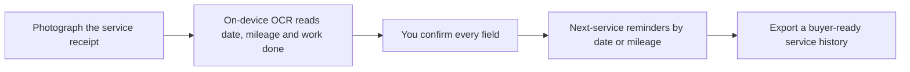

<div align="center">
  <picture>
    <source media="(prefers-color-scheme: dark)" srcset="branding/pitfile-wordmark-on-dark.png">
    
  </picture>

  <p><strong>Every service, on file. Every deadline, on time.</strong></p>

     
</div>

> **Status: in design.** Pitfile is a fully briefed and branded product concept. The plan, scope and open questions are documented; the app has not been built yet.

## The idea

Photograph a car service receipt and Pitfile logs the date, mileage and work done, reminds you when the next service is due, and builds a clean service history you can hand to a buyer.

- **For:** Car owners who forget service intervals and can't find their records when selling.
- **Outcome:** Never miss a service, and hand over a complete service history when the car is sold.

## How it will work



## Planned features

- On-device receipt reading with Apple Vision
- Reminders by date and mileage
- Owner-set service intervals (never invented by the app)
- Clean, shareable service history for resale
- Local storage, no account

## Tech plan

| Layer | Choice |
|---|---|
| Language / UI | Swift, SwiftUI (iOS 17+) |
| Text recognition | Apple Vision (on-device) |
| Storage | Local |
| Reminders | Local notifications |
| Backend | None |

## Privacy by design

Service records stay on the device. No account.

## Open decisions

Tracked openly in [`docs/PROJECT_BRIEF.md`](docs/PROJECT_BRIEF.md). A few of the big ones:

- This category is crowded with car-maintenance log apps. What is the clear difference (receipt photo first, privacy, clean buyer-ready history)?
- Reminders by date and by mileage: how does the app know the current mileage (owner updates it, odometer photo, or an estimate from average use)?
- Where do default service intervals come from? Manufacturer schedules are not to be invented; user-entered only, or a vetted source?
- Optional recall lookup by VIN uses a public government API and needs the network: in v1 or later?

## Brand

| | Name | Hex | Role |
|---|---|---|---|
|  | Pit Red | `#C1121F` | Icon field, accent, due-soon states |
|  | Cream | `#FFF1E6` | Service page, light surfaces |
|  | Graphite | `#1D1D1F` | Text, dark surfaces |
|  | Steel | `#6B7280` | Secondary text |

**Mark.** A service page with a folded corner and an odometer gauge: the record and the mileage in one mark.

**Voice.** Practical and to the point, like a good mechanic. Say what is due and when. No car jargon unless the owner used it first.

Full logo set (mark, wordmark, app icon in light and dark) and the brand guide are in [`branding/`](branding/BRAND_GUIDE.md).

## Repository contents

```
docs/PROJECT_BRIEF.md   Confirmed requirements, assumptions, open questions, scope
branding/               Logo files and BRAND_GUIDE.md
```

## License

Proprietary. Shared publicly for portfolio and demonstration purposes only. See [LICENSE](LICENSE).

---

<div align="center">

Built by [Aquila Digital LLC](https://github.com/Steven6Brown) · *Per Aspera Ad Astra*

</div>
